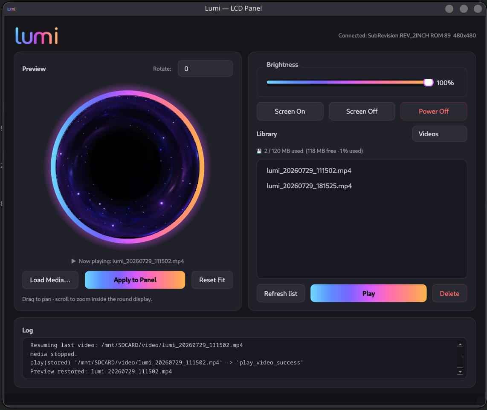
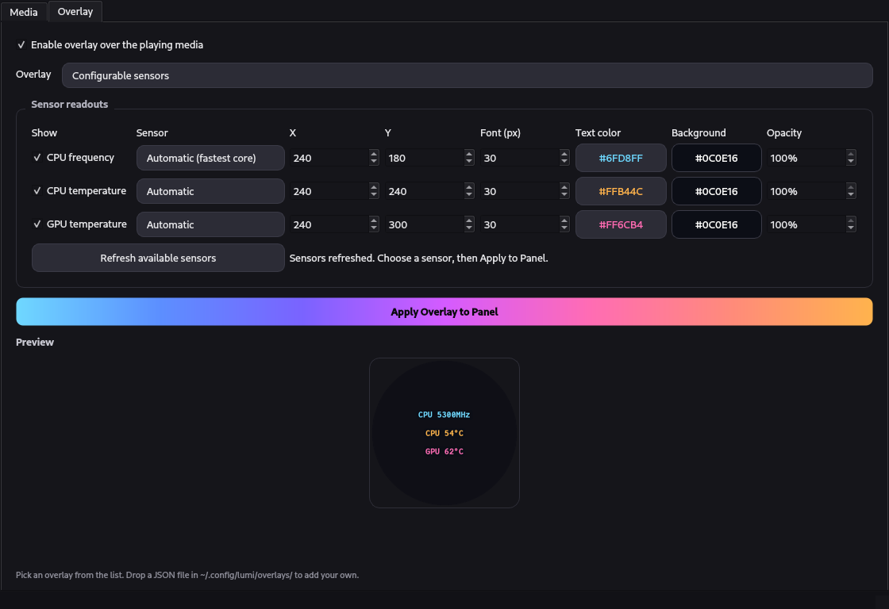

# Lumi

**Lumi is the open-source replacement for ID-COOLING's LCD software on Linux.**

ID-COOLING's official customization software is **Windows-only** — Lumi brings
full control of the round display to Linux. Show images, GIFs, and videos on
your AIO cooler's screen, position them in a live round preview (drag / zoom /
rotate), then push them to the panel. Open-source and built natively for Linux.



> **Built for:** the ID-COOLING **Space Series AIO** (SL240, SL360, …) — liquid
> CPU coolers with a built-in 2.1" round LCD. Also compatible with other rev C
> panels (SAMA / TURZX) and anything speaking the same USB-CDC serial protocol.

## Features

- **Live round preview** — load an image, GIF, or video, then **drag to pan,
  scroll to zoom**, and rotate (0 / 90 / 180 / 270°). What you see is exactly
  what shows on the device, corners clipped by the bezel.
- **One-click upload** — images, GIFs, and videos are transcoded (ffmpeg →
  480² H.264, 24 fps) and pushed to the panel's media library, then loop.
- **Stored-media browser** — list and play anything already on the device.
- **Brightness, screen on/off, and power off.**
- **Live overlays** — render a clock or configurable CPU frequency, CPU
  temperature, and GPU temperature over the playing media. Select sensors and
  set each readout's position, font size, text/background color, and background
  opacity in the GUI. Lumi refreshes the overlay while the panel plays the
  video underneath.
- **Autostart + clean shutdown** — an optional daemon resumes your last media on
  boot and turns the panel off when the PC shuts down.
- **Persistent settings** — brightness and last media survive restarts.

## Supported panel

Lumi was built and tested against the **ID-COOLING Space Series AIO** (e.g.
SL240 / SL360) — the **2.1" round (480 × 480)** rev C USB-CDC panel built into
those coolers. The whole app is tailored to it: a live round preview, a
circle-masked media pipeline, and a 480² H.264 transcode.

The underlying rev C serial transport is resolution-agnostic (vendored from
[turing-smart-screen-python](https://github.com/mathoudebine/turing-smart-screen-python)),
so other rev C sizes from the same family (2.8" / 3.5" / 5" / 8.8") *can* be
targeted with `lumi --size` / `--width` / `--height`, but they're **untested**
and the round-focused UI isn't designed for the rectangular panels.

The panel enumerates asleep as `1a86:ca21` ("UsbMonitor", serial `CT21INCH`);
Lumi wakes it and it re-enumerates as `1d6b:0121`. All of this is automatic.

## Install (Linux)

Clone or download this folder **anywhere**, then:

```bash
./install.sh
```

That's it. The install is self-contained under your home directory (a persistent
venv at `~/.local/share/lumi/venv`, with `lumi` placed on `~/.local/bin`), so you
can **move or delete this folder afterwards**. You'll get two sudo prompts:

1. A udev rule so the panel is accessible without root.
2. `loginctl enable-linger` so the daemon can start at boot.

Then `lumi` works in any shell (fish / bash / zsh) with no activation.

## Quick start

```bash
lumi gui                  # the desktop app (main interface)
lumi info                 # detect the panel + show sub-rev / ROM
lumi brightness 60        # 60 % backlight
lumi video clip.mp4       # transcode → upload → loop
lumi image photo.jpg      # convert → upload → show
lumi gif anim.gif         # GIF → MP4 → upload → loop
lumi ls video             # list videos on the device
lumi ls images            # list images on the device
lumi play SPACE_03.mp4    # play a stored clip
lumi --help               # everything else
```

### The GUI

`lumi gui` opens the main window:

- **Left** — the round preview. **Load Media…**, position it (drag / scroll /
  rotate), then **Apply to Panel**.
- **Right** — brightness, Screen On / Off / **Power Off**, and the list of stored
  videos (double-click to play).
- **Bottom** — a log of the serial traffic (ACKs, transcodes, errors).

The GUI and the daemon share one serial port: launching the GUI **pauses the
daemon** and takes over; closing the GUI **hands back to the daemon**, so
boot-resume and shutdown power-off keep working.

## Autostart + clean shutdown

The install enables a systemd **user** daemon that:

- On **boot**: wakes the panel and resumes the last media you applied.
- On **shutdown**: sends a power-off so the panel goes dark.

Logs: `journalctl --user -u lumi -f`. Control: `systemctl --user {start,stop,restart} lumi`.

## Uninstall

```bash
./uninstall.sh            # removes app + service + venv; keeps your settings
./uninstall.sh --purge    # also wipes ~/.config/lumi + ~/.local/share/lumi
```

It stops/disables the service, removes the `lumi` command and the persistent
venv, and (with sudo) the udev rule. Your brightness/last-media settings are kept
by default so a reinstall resumes where you left off; `--purge` wipes them.

## Orientation

2.1" round panels are typically mounted rotated 90° CCW, so Lumi pre-rotates
content clockwise by default (`--rotate 90` on the CLI; a dropdown in the GUI).
Override with `--rotate 0|90|180|270` if your panel is mounted differently.

## Live overlays

### Configurable sensor readouts

Open the **Overlay** tab and choose **Configurable sensors**. Each readout has
a checkbox, a sensor selector, X/Y position, font size, text color, background
color, and background opacity (0–100%). Text remains opaque when the background
is made transparent.
Click **Refresh available sensors** to discover individual CPU cores and
temperature channels. **Automatic** uses the representative CPU/GPU reading;
you can choose a specific channel or GPU instead. Automatic CPU frequency uses
the **highest current core frequency**, rather than the average across cores;
if per-core readings are unavailable, it falls back to the system CPU frequency.
You can still select an individual core. Positions are the text center
in the 480 × 480 panel coordinates (240, 240 is the center); font sizes are
in panel pixels. Use the round preview to keep text inside the bezel.
Readouts default to compact dark backings for legibility and to stay within the
panel's overlay mask limit; customize them using the background controls.



Changes update the preview and are saved immediately. Click **Apply Overlay to Panel**
to activate them on the display. The daemon restores the saved readouts after
the GUI closes. Unavailable or disconnected sensors display `--`.

The installer includes `psutil` for CPU frequency and Linux temperature sensors.
For a manual installation, use `pip install '.[gui,sensors]'`. Installing your
distribution's **lm-sensors** package adds temperature channels via `sensors -j`.
NVIDIA temperatures are also read through **nvidia-smi** when it is available.
Available channels depend on the hardware and installed drivers.

Settings live in `~/.config/lumi/overlay.json` under `stats`, keyed by
`cpu.freq`, `cpu.temp`, and `gpu.temp`. Each stores `enabled`, `source`, `x`,
`y`, `size`, `color`, `background_color`, and `background_opacity` (percent);
the selected layout is `"layout": "sensors"`.

Live readings require Lumi to keep running. When the GUI closes, an enabled
`lumi.service` resumes the overlay in the background. Manual installations can
enable the installed user service with `systemctl --user enable --now lumi`.
On the tested 2.1" panel, full overlay transfers result in updates roughly every
10 seconds, despite the layout's two-second polling interval. Closing the GUI
can leave a gap of about 15 seconds while the daemon resumes playback and sends
its first overlay. Other panels and firmware versions have not been tested.

### Clock overlay

Lumi can render a **live clock over a playing video** — the same feature the
official Windows app offers on this panel.

The mechanism (reverse-engineered from the official app and verified on the 2.1"
rev C, ROM 89): while a video plays from device storage, Lumi sends two commands
that establish a **persistent overlay layer** on top of it —

* **cmd 202 (0xCA)** — the overlay *colours* (the full 480×480 frame, raw BGRA);
* **cmd 208 (0xD0)** — the *visibility mask* (the regions where the overlay is
  opaque, i.e. where the clock is), so the video shows through everywhere else.

The overlay persists until re-sent, so the clock only needs refreshing when its
digits change (once a minute for `HH:MM`). It runs from the daemon, so it stays
on after you close the GUI.

```bash
lumi overlay            # play the last video + run the clock overlay (Ctrl-C to stop)
lumi overlay --bg IMG   # clock over a static image instead of video
lumi overlay --enable   # enable the overlay for the daemon, then exit
lumi overlay --disable  # disable it, then exit
```

- **GUI:** choose *Clock* in the Overlay tab and enable the overlay; it is
  drawn on the panel and mirrored in the round preview.
- **Config:** `~/.config/lumi/overlay.json` selects the layout:

  ```json
  {
    "enabled": true,
    "layout": "clock"
  }
  ```

Additional layouts can be added as widget specs in JSON files under
`~/.config/lumi/overlays/`. For example, save this as `custom-clock.json`,
then select **Custom clock** in the GUI:

```json
{
  "id": "custom-clock",
  "label": "Custom clock",
  "interval": 1.0,
  "widgets": [
    {"type": "text", "data": "clock.time", "pos": [240, 240],
     "size": 60, "color": "#FFFFFF", "plate": {"alpha": 255}}
  ]
}
```

Background opacity is encoded in the RGBA overlay and shown in the preview.
The panel's visibility mask has a binary alpha threshold, so low-opacity edges
and intermediate blending can differ from the preview depending on firmware.

> Technical note: the overlay colours/mask commands (cmd 202/208) are distinct
> from the *primary* bitmap command (cmd 200/0xC8), which the video decoder
> output covers. Sending cmd 200 over a playing video does nothing visible and
> must not be hammered (it can desync the panel — recover with `sudo usbreset
> 1d6b:0121` or a replug).

## How media is stored (power-user notes)

The device runs Linux and stores media in its onboard flash:

```
/mnt/SDCARD/video/   video library (clips loop on play)
/mnt/SDCARD/img/     image library
/mnt/UDISK/...       USB-disk media (if present)
```

- Uploaded videos keep the source name; re-uploading the same name **overwrites**.
- `lumi ls <path>` lists any device directory.
- The serial protocol has **no file-delete command** in the stock app (its delete
  button only removed local references). Lumi additionally implements a delete
  opcode to actually free space — see `lumi rm --help`.

## Troubleshooting

- **"could not open port / No such file"** — the panel is asleep or mid-wake.
  Retry; Lumi wakes it automatically and retries several times.
- **Permission denied on the serial port** — make sure the udev rule is installed
  (`sudo cp 99-lumi.rules /etc/udev/rules.d/ && sudo udevadm control --reload &&
  sudo udevadm trigger`), then unplug/replug the panel.
- **Wrong video on restart** — apply the media you want from the GUI (or
  `lumi play <name>`); Lumi persists the last-applied media for resume.
- **Panel didn't turn off at shutdown** — ensure the daemon is running
  (`systemctl --user is-active lumi`) and linger is enabled
  (`loginctl show-user $USER | grep Linger`). The daemon must own the panel at
  shutdown (close the GUI first).
- **Stats freeze / panel write times out** — Lumi now resets the affected
  panel's USB connection after a failed reconnect and resumes live updates.
  Re-run `./install.sh` to update older udev rules; the USB recovery needs
  access to the panel's USB device node as well as its serial port. Resets
  are limited to known panel IDs on the failing serial port and have a
  one-minute cooldown.

## Development checks

```bash
python -m pip install '.[gui,sensors,test]'
QT_QPA_PLATFORM=offscreen python -m pytest
```

Tests use simulated sensor backends and serial connections; no panel or root
access is required. GUI tests are skipped if PySide6 is not installed.
Physical-panel checks should also cover applying a layout over a playing video,
changing media, disabling/re-enabling the overlay, and closing/reopening the
GUI while the user daemon is enabled.

## Credits & license

GPL-3.0-or-later. The rev C serial transport in `src/lumi/lcd/` is vendored from
[`turing-smart-screen-python`](https://github.com/mathoudebine/turing-smart-screen-python)
(GPL-3.0-or-later, © Matthieu Houdebine et al.). The media pipeline, GUI,
round-preview, and device-storage support are original to Lumi.
